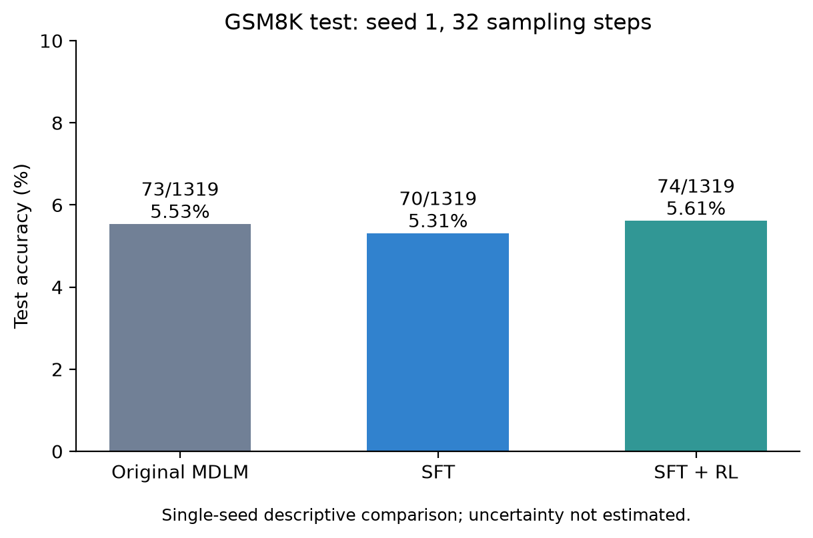
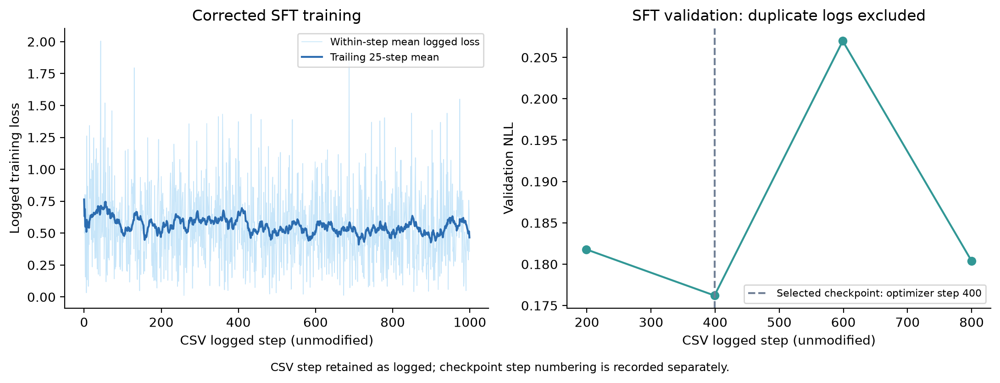
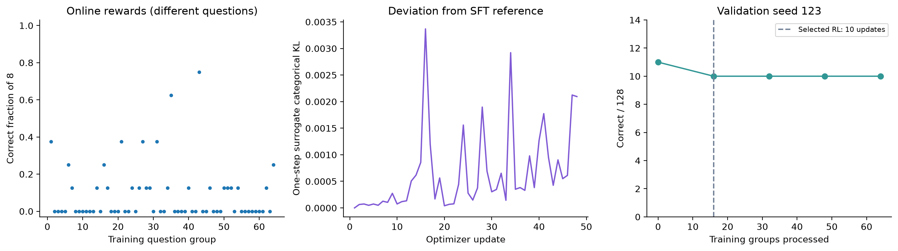
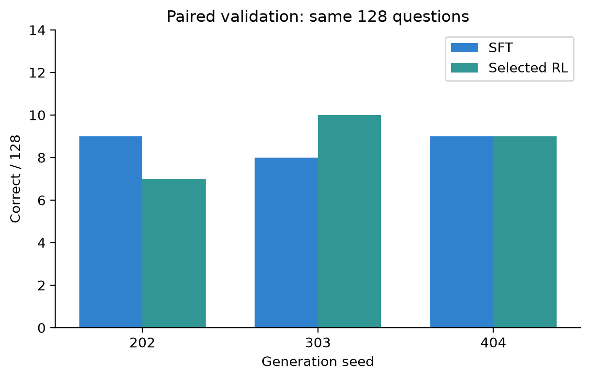

# 基于 TinyGSM 预训练 MDLM 的 SFT 与 RL 小规模实验

## 1. 研究问题与主要发现

选择作业方向一：基于预训练扩散语言模型，完成监督微调（SFT）、探索适用于该模型的强化学习（RL），并在统一设置下比较模型表现。使用 TinyGSM 预训练的 MDLM checkpoint，模型日志显示约 167M 参数；`SmolLM-135M` 在本实验中是 tokenizer 标识，不代表训练了一个自回归 SmolLM 模型。

为解释本轮实验，将工作归纳为两个研究问题。这是报告的组织框架，不表示此前已完成正式的实验预注册。

- **问题一：**对 TinyGSM 预训练 MDLM 继续进行答案区域 SFT，能否改善当前设置下的 GSM8K 表现？
- **问题二：**在起点正确率较低、二元奖励较稀疏的条件下，MDLM 上的 diffu-GRPO 适配能否带来进一步收益？

回答问题一需要比较原始模型与 SFT；回答问题二需要固定 SFT 起点、明确 RL 目标和选模规则，再比较 SFT 与 RL。训练能运行、参数会更新属于实现有效性检查，不能代替性能证据。

本轮完成了数据准备、SFT、小规模 RL、验证集选模、三种子验证及统一测试，结果如下。

| 模型 | GSM8K 测试正确数 | 准确率 | 评估权重 |
|---|---:|---:|---|
| 原始 MDLM | 73/1319 | 5.53% | 原始 checkpoint 的 EMA |
| 修正版 SFT | 70/1319 | 5.31% | 验证集选出的第 400 步 EMA |
| SFT + RL | 74/1319 | 5.61% | 验证集选出的 group016，实际更新 10 次 |

三者均采用 seed=1、32 步 ancestral 采样、总序列长度 512、评估 batch size=2。RL 相比 SFT 净增加 4 题，约增加 0.30 个百分点；相比原始模型净增加 1 题，约增加 0.08 个百分点。

**结论限定：本轮只观察到单种子测试的轻微数值提升，没有证据表明稳定提升。** 在另外三个预先指定的验证采样种子下，固定 SFT 与固定 RL checkpoint 的总正确数均为 26/384。SFT 本身也没有超过原始模型。

因此，对问题一，本轮未观察到测试正确率收益；对问题二，工程流程可用，但现有结果不足以支持稳定的性能收益。这些结论只适用于本次模型、数据规模和采样设置，不能推广为“SFT 或 RL 对 MDLM 无效”。

## 2. 模型原理与技术路线

MDLM 将离散 token 逐步替换为 mask，再学习从被遮盖的序列恢复原 token。训练可表述为带权重的 masked-language-modeling 损失；生成则从被遮盖的答案区域开始，经过多次去噪形成文本。这与逐个预测下一个 token 的自回归生成不同。[MDLM 原始论文](https://arxiv.org/abs/2406.07524)

本地配置使用 absorbing diffusion、DiT backbone、双向注意力、`time_conditioning=False`、`loss_type=elbo`。推理时固定问题前缀，只生成其后的内容；代码型回答由评分器寻找并调用 `simple_math_problem()`，将结果与 GSM8K 数值答案比较。

技术路线围绕数据、权重和评估条件的一致性展开：

1. 核验环境与原始模型，建立原始测试基线。
2. 从 TinyGSM 获取监督样本，完成过滤、去重、划分和哈希记录。
3. 保持问题为条件，只对答案及 EOS 区域训练，运行 SFT 并按验证 NLL 选模。
4. 从 GSM8K 训练集建立单独的 RL 训练、验证划分。
5. 先检查奖励与输入格式，再实现策略更新，最后开展固定预算 RL。
6. 固定验证集选出的 checkpoint，完成多种子验证和同口径测试。

### 关键设计的依据与代价

以下说明各项设置在本实验中的作用，并列出尚未验证的部分。它们是小规模试验的实现选择，不是经搜索得到的最优参数。

| 设计 | 作用或选择依据 | 代价与尚未回答的问题 |
|---|---|---|
| 答案区域 SFT | 让问题保持为条件，将监督集中在答案代码和 EOS | 未比较问题区域也参与训练的设置 |
| 生成总长度 512、采样 32 步 | 固定已有基线设置，使三方结果具有可比性 | 尚未确认长度与采样预算是否限制正确率 |
| 每题生成 8 个回答 | 给组内提供不同奖励的机会，同时控制生成成本 | 仍有 40/64 组全错；没有比较其他组大小 |
| 单步去噪概率近似 | 避免直接处理完整多步生成的概率计算成本 | 近似目标与实际多步生成奖励不完全一致 |
| 固定 SFT 参考模型与 KL 正则 | 在奖励更新之外限制相对起点的变化 | KL 系数未消融，且约束的是近似分布 |
| 同奖励组跳过更新 | 奖励优势为零时不进行该组的优化计算 | 同时跳过 KL 更新，改变了有效更新分布 |
| 固定抽取 64 道训练题 | 先用受控预算观察训练与验证行为 | 实际只有 48 次更新，不能代表充分训练的结果 |

控制实验规模有助于尽早发现实现错误，但不能据此将“没有明显收益”归因为“训练量不足”。后者还需要独立的预算对照。

## 3. 数据划分与实验边界

实验使用单张 NVIDIA RTX 4090，在 WSL Ubuntu 的 `sfm` 环境中运行。完整环境版本和源码定位见附录 A；正文重点说明哪些数据用于更新、选模和最终报告。

### SFT 数据

从 TinyGSM 取得 12000 条样本。过滤空内容、无效 Python 语法、缺少预期函数、超长样本，并排除规范化后完全相同的测试问题及重复问题。此次计数为：超长 16 条、重复问题 10 条，保留 11974 条；seed=42 划分为训练 10777 条、验证 1197 条。

过滤只检查格式等基本条件，**没有验证所有训练程序的数学正确性**。完全相同问题的排除也不能排除改写后的语义重叠。由于原模型已在 TinyGSM 上预训练，不能声称本地 SFT 验证集从未被模型见过。

修正分隔符后重新计算了长度。保留样本数和两份划分文件的哈希均未改变，因此新旧 SFT 的监督样本和划分一致。

### RL 数据

使用 `openai/gsm8k` 的 `main/train`，共 7473 条。准备脚本排除与测试集、SFT 训练及验证问题的规范化完全重叠，再按固定种子划分为 RL 训练 512 条、验证 128 条、保留 6833 条。本次 7473 条均满足准备阶段条件；这不代表没有语义级重叠或预训练暴露。

正式小规模试验从 512 道 RL 训练题中按 seed=42 固定抽取 64 道。128 道 RL 验证题不参与参数更新。GSM8K 的 1319 道测试题用于报告测试结果，不用于挑选本轮 RL checkpoint。

SFT 的 1197 条验证样本用于选择 SFT checkpoint；RL 的 128 道验证题用于选择 RL checkpoint。它们不是同一套验证数据，指标也不同：前者使用验证 NLL，后者使用执行答案正确数。不能把两者的变化直接当作同一个学习指标比较。

实验为迭代开发过程：期间已经查看过原始、历史 SFT、修正版 SFT 和 RL 的测试结果，因此不能将全过程描述为完全未接触测试集的一次性盲测。上述 checkpoint 选择依据是验证指标；但既有测试结果可能影响后续研究关注点。10 月 24 日追加的 EMA 对照仅使用既有 RL 验证题，属于事后探索性诊断，不是新增独立测试证据。测试问题文本曾用于精确重叠排除，这与用测试答案更新参数或按测试分数选模应区别说明。

## 4. SFT 实现与结果

输入结构为 BOS、问题、配置指定的分隔符、答案代码、EOS，再补齐到 512 tokens。问题及 padding 的损失 mask 为 0，答案和 EOS 为 1。该仓库还用这一 mask 控制问题区域保持干净，避免把条件问题当作待去噪答案。

本文沿用日志中的 `val/nll` 指标名称；在当前 `loss_type=elbo` 的扩散训练设置中，它来自带权去噪损失估计，不应解释为直接计算出的完整生成序列精确负对数似然。

| 项目 | 设置 |
|---|---|
| 初始化 | 原始 `checkpoints/tinygsm/mdlm.ckpt` |
| 更新预算 | 1000 个 optimizer steps |
| batch / 梯度累积 / 有效 batch | 4 / 4 / 16 |
| 学习率 / warmup | 1e-5 / 50 步 |
| 精度 | bf16-mixed |
| 验证 | 全部 1197 条；按既定训练批次间隔触发 |
| 选模 | 验证 NLL 最低 |
| 最佳 checkpoint | 第 400 步，验证 NLL 0.1762108 |
| 训练 fit 耗时 / 峰值已分配显存 | 347.44 秒 / 6.87 GiB |

图中横轴保留 CSV 原始步数。有效验证记录位于日志步数 199、399、599、800；日志步数 399 对应被选中的第 400 步 checkpoint。仓库 `on_train_epoch_end` 会重新写入现有验证指标，673 和 999 的记录分别重复此前值，并不代表新的验证，所以图中剔除这两点。该修正不改变选模结果。

训练损失有波动，验证 NLL 也没有单调下降。测试结果为 70/1319，低于原始模型的 73/1319。因此不能将验证 NLL 的变化直接解释为解题能力提高。

对研究问题一，当前证据只支持“这次配置下的 SFT 没有提高单种子测试正确率”。答案去噪目标与最终程序执行正确率并不相同，存在指标不一致的可能；但尚未做训练目标或数据质量对照，因此不能把它认定为此次下降的已知原因。

### 4.1 追加诊断：EMA 是否掩盖了普通权重的表现？

短程 SFT 使用 EMA 衰减系数 0.9999，因此提出假设：EMA 变化滞后可能掩盖普通权重的性能。先检查实现与 checkpoint，确认 EMA 更新次数从预训练的 250000 延续到 250400 和 251000，每次优化器更新后更新一次。实现的有效衰减为 `min(decay, (1 + num_updates) / (10 + num_updates))`；在本次计数范围内实际一直为 0.9999。按 EMA 展开式，400 和 1000 步后初始 EMA 的系数分别约为 96.08% 和 90.48%。这只是权重平均中的系数，不能解释成学习能力或知识保留比例。

固定第 400 步 checkpoint，对比其保存的普通权重与 EMA 权重。使用相同的 128 道 RL 验证题、种子 202/303/404、batch size=1、长度 512、32 步 ancestral 采样和原评分器；不训练，不使用测试集。加载后明确禁用自动 EMA 切换，并检查两套参数并非完全相同。

| 种子 | EMA 正确数 | 普通权重正确数 | 普通权重原错变对 | 普通权重原对变错 |
|---:|---:|---:|---:|---:|
| 202 | 9/128 | 4/128 | 2 | 7 |
| 303 | 8/128 | 5/128 | 2 | 5 |
| 404 | 9/128 | 3/128 | 2 | 8 |
| 合计 | 26/384（6.77%） | 12/384（3.13%） | 6 | 20 |

EMA 结果复现此前同种子的 SFT 验证结果。普通权重在三个采样种子下均较低，累计少 14 个正确回答。对保存回答进行静态语法诊断：

| 指标 | EMA | 普通权重 |
|---|---:|---:|
| 原始文本通过 `ast.parse` | 203/384（52.86%） | 156/384（40.63%） |
| 包含预期函数名字符串 | 384/384 | 384/384 |
| 原始文本语法通过但评分错误 | 177 | 144 |

包含函数名只是字符串检查，不能证明函数定义有效。语法通过也不保证可执行或数学正确；这些诊断与评分器的代码提取及执行口径不同，不能据此把净少的 14 个正确回答全部归因于语法变化。

**判断更新：该对照不支持通过直接停用 EMA 改善第 400 步 checkpoint 的表现，因此保留原 EMA 评测口径。** 它没有比较重新训练后的不同 EMA 衰减系数，也没有单独验证过拟合、灾难性遗忘或训练量不足，不能证明 0.9999 最优。三个种子复用同一批 128 道题，不是 384 道独立题或多个独立训练种子。

该次对照报告耗时 235.80 秒、峰值 allocated 显存 1.69 GiB。计时在两套模型加载与参数差异检查之后开始，覆盖采样、评分及结果写入，不含准备阶段；无新增训练。结果目录为项目下的 `outputs/sft_ema_vs_raw_20261024_165836_733187`。本次 12 个原始文件（含六份逐题回答和执行脚本）已归档并通过源文件与副本 SHA256 校验；逐题记录的正确数已核对，与汇总一致。语法统计仍依据执行者提供的终端输出，未在归档过程中重跑。详见 [EMA 对照记录](evidence/ema_diagnostic_20261024.md)。

## 5. RL 方法：MDLM 上的 diffu-GRPO 适配

diffu-GRPO 为 masked diffusion 模型构建单步去噪概率估计：遮盖完整答案，并随机遮盖部分问题，利用一次前向得到答案 token 概率，代入组相对策略优化目标。这是近似估计，并非完整多步生成序列的精确似然。[d1 / diffu-GRPO 原始论文第 3 节](https://arxiv.org/html/2504.12216v2)

本实验依据这一思想做了具体适配，而非声称完整复现论文训练配方：

- 每道题从当前策略采样 8 个回答，32 步生成，代码执行答案正确得 1，否则得 0。
- 优势为 `A_i = reward_i - mean(group_rewards)`，不按组标准差归一化。
- 同一组做两次内部更新；每次随机遮盖问题 token 的概率为 0.15，保护 BOS 与分隔符，完整遮盖答案区域。
- 在参数更新前缓存两个遮盖模式下的旧策略概率；当前、旧策略和参考模型比较时使用同一遮盖输入。
- 使用逐 token 概率比的裁剪目标，epsilon=0.2；学习率 1e-6，梯度范数上限 1。
- 参考模型固定为 SFT EMA。正则项为单步近似分布上的完整词表 categorical KL，系数 0.01，并按答案区域位置平均。
- 概率在 float32 中重新归一化，排除 mask token。代码沿用长度 512 的完整生成后缀，不在首个 EOS 处截断，与本次已有评分流程保持一致。
- 使用 `eval()` 关闭随机训练层行为，但保留策略参数梯度；这不等于禁止参数更新。参考模型则冻结参数。

实现中的最小化损失可概括为：

`loss = -mean[min(ratio * A, clip(ratio, 0.8, 1.2) * A)] + 0.01 * KL`

其中 `ratio` 是当前模型与更新前模型，在相同遮盖输入下对已采样答案 token 的近似概率之比。高于组均值的奖励产生正优势，低于组均值产生负优势；裁剪用于限制目标中的比例变化，KL 则约束相对固定参考模型的偏离。缓存旧策略概率并对齐遮盖模式，是避免把输入扰动误当成策略变化的必要检查。

这里的 `ratio` 和 KL 都属于**单步近似模型**，不能写成精确轨迹概率比或精确多步生成分布 KL。采用完整 categorical KL、MDLM 小模型、代码执行奖励和两次内部更新，均需作为本实验实现选择公开说明。

全错或全对题组的奖励优势为零，本次跳过这些题组的全部更新，包括原本可单独计算的 KL 更新。该选择降低计算量，也改变了实际优化采样分布，是方法局限之一。

### 权重一致性与小规模验证

初始化时将 SFT EMA 一次性复制到实际策略参数，随后禁用 EMA 切换与重新平均，避免生成用 EMA、更新却恢复另一组参数。参考模型复制自同一起点。导出时将当前 RL 参数镜像到 checkpoint 的 EMA 槽，以兼容原项目评估接口；这不是训练了新的 RL EMA。

两步更新验证检查了初始概率比为 1、初始参考 KL 为 0、奖励方向、有限且非零的梯度、参数确实变化，以及保存后重载权重逐项一致。验证成功后，正式试验重新从 SFT 起点开始，没有沿用验证产生的权重。

## 6. RL 小规模试验与选模

预算为 64 道训练题，每题 8 个回答，共 512 个在线回答。24 个题组有不同奖励，40 个题组全错，没有全对组，因此完成 24×2=48 次参数更新。训练前及每处理 16 道题，使用 seed=123、batch size=1、32 步采样评估相同的 128 道验证题。验证采用独立的随机数上下文，结束后恢复训练随机状态。

| 处理题组数 | 累计参数更新 | 验证正确数 |
|---:|---:|---:|
| 0（SFT 起点） | 0 | 11/128 |
| 16 | 10 | 10/128 |
| 32 | 26 | 10/128 |
| 48 | 36 | 10/128 |
| 64 | 48 | 10/128 |

四个 RL 候选并列，按预先设定的“并列时选最早”规则，选择 `group016.ckpt`。**它只经过 10 次 RL 更新；48 次是整个试验的总更新数。** “最佳 RL 候选”不代表超过了 SFT 起点。

梯度范数为 0.030～0.604，未达到裁剪阈值 1；单步近似 KL 最大约 0.00337；概率比超出裁剪区间的比例最高约 0.21%。这些日志没有显示数值爆炸，但也不能证明近似目标有效优化了实际正确率。每个奖励点来自不同训练题，不能把这条散点序列当作固定题集上的学习曲线。

试验总耗时 338.68 秒，包含验证和保存等工作；不是纯训练耗时。峰值已分配显存约 3.96 GiB。所有显存数字均为 PyTorch allocated 统计，并非整机 GPU 占用或 reserved 显存。

计算开销口径：SFT 的 347.44 秒来自 `trainer.fit` 区间，包含该区间内的训练、验证和回调开销；RL 的 338.68 秒为其试验循环区间，包含验证和保存。两者工作量与计时边界不同，不能直接用这两个数字推断训练效率高低。初始化、数据准备、历史排错和后续评测也未全部计入，因此它们不是整个项目的总 GPU 时间；尚未据此核算实际人民币成本。

## 7. 多种子验证与测试集逐题对照

固定 `group016.ckpt` 后，用新增种子 202、303、404 配对比较 SFT 与 RL，不再按这三个种子重新选择 checkpoint。

| 种子 | SFT | RL | 净变化 |
|---:|---:|---:|---:|
| 202 | 9/128 | 7/128 | −2 |
| 303 | 8/128 | 10/128 | +2 |
| 404 | 9/128 | 9/128 | 0 |
| 合计 | 26/384 | 26/384 | 0 |

这是同一批 128 道题的重复采样，不是 384 道独立问题，更不是新测试集。总分相同不能证明模型等效，但不支持稳定收益的说法。

随后对固定 RL checkpoint 完成一次同口径测试。对三份已保存的测试回答再次使用原评分器评分，总分严格复现为 73、70、74。按相同问题和标准答案对齐后：

| 对比 | 原错变对 | 原对变错 | 净变化 |
|---|---:|---:|---:|
| 原始 → SFT | 5 | 8 | −3 |
| SFT → RL | 7 | 3 | +4 |
| 原始 → RL | 6 | 5 | +1 |

原始回答通过 Python 静态编译的数量分别为 716、704、721。这只检查语法；官方评分器还会提取代码、执行函数并核对数值，两者不能混为一谈。

原结果文件中的 `accuracy_se=0`、上下界等于准确率，是 `bootstrap_size=1` 时的默认记录方式，不代表估计没有不确定性。因此另做以下统计检验：

| 比较 | 不一致题（原错变对 / 原对变错） | McNemar 精确检验双侧 p |
|---|---:|---:|
| 原始 → SFT | 5 / 8 | 0.58 |
| SFT → RL | 7 / 3 | 0.34 |
| 原始 → RL | 6 / 5 | 1.00 |

三者的 95% 正态近似置信区间分别为 4.30%–6.77%、4.10%–6.52%、4.37%–6.85%，高度重叠。三组配对差异均远未达到 0.05 显著性水平：测试集上的 −3 与 +4 题处于单种子采样波动范围内，与多种子验证持平的结果一致。作为对照，第 4.1 节 EMA 与普通权重的差异（不一致回答 20 / 6）在同一检验下 p≈0.009；但三个种子复用同一批题，配对并不完全独立，该 p 值只作参考。

## 8. 案例展示与错误类型

案例按测试文件顺序，各类别取前两条，完整原文见 [案例文件](evidence/cases.md)，并非按展示效果人工挑选。以下题号为从 0 开始的索引。

| 索引 | 现象 | 可以支持的解释 |
|---:|---|---|
| 139 | 原始与 SFT 含未闭合字符串；RL 正确执行并返回 70 | 语法修复带来正确回答，不足以单独证明推理增强 |
| 168 | SFT 使用未定义变量；RL 恢复 `2*8+2`，返回 18 | RL 恢复了一道原模型已能答对的题 |
| 48 | 原始与 SFT 正确；RL 缺少 `piece_length` 定义 | 运行时错误导致退化 |
| 834 | SFT 使用速度 8；RL 使用速度 0 | 数值设置错误导致退化 |
| 1 | 三个模型都计算了所需总量，却最终返回常数 10 | 局部计算看似合理，但返回结果错误 |

这些案例表明瓶颈包括语法、变量一致性、数值赋值、结果返回及数学逻辑。当前二元奖励不会区分这些失败类型。

## 9. 关键排错案例：从零奖励定位输入格式不一致

这一案例说明，模型输出异常时应先验证输入与执行流程，而不是直接将结果归因于模型能力或奖励稀疏。

1. **异常现象。**早期自定义奖励探测得到 0/128，输出中缺少预期函数；同一旧 SFT checkpoint 通过原项目评估流程对同一批重复问题得到 11/128，且 128 个输出均包含预期函数。这提示需要比较两条输入和生成路径。
2. **先排除一个假设。**本地与原 tokenizer 的词表映射及所检查的编码一致。但早期前缀对比在两侧都硬编码了同一个真实换行，未检查配置实际取值，因此不能证明真实前缀一致。
3. **进一步检查字符与 token。**自定义脚本的分隔符是真实换行，字符码 `[10]`、token `[198]`；仓库 YAML 配置的单引号字符串是字面量反斜杠+n，字符码 `[92,110]`、token `[76,94]`。词表相同，拼接输入仍然不同。
4. **固定 checkpoint 做针对性修复。**探测脚本改为读取配置中的分隔符，其他既定探测设置保留，得到 14/128；没有更新模型参数。它与原项目流程的 11/128 不要求逐题一致，因为两条生成流程尚未逐项完全对齐。
5. **修复受影响的训练流程。**同样的问题存在于自定义 SFT 脚本，因此重新准备数据并从原始模型重跑 SFT。数据划分哈希未变；新 SFT 的奖励探测为 12/128，有 7 个混合奖励组。

**修复确认的是输入一致性和奖励流程可用，不是性能提升。**修正版 SFT 的测试成绩为 70/1319；此前分隔符不一致的旧版 SFT 曾为 75/1319。旧结果作为历史记录保留，不因分数较高而纳入修正后的主对照。错误来自本地自定义脚本，不归因于仓库。

这次排错的可复用经验是：不能只检查 tokenizer 名称或词表；还应记录实际字符串、特殊 token、分隔符 token IDs 和最终前缀。环境安装等其他问题汇总在附录 B。

## 10. 结果解释、局限与后续研究

### 10.1 为什么三个模型的准确率都较低？

首先，原始模型在相同测试设置下也是 5.53%，因此低分并非全部由后续 SFT 或 RL 造成。其次，1319 个原始回答中，仅 716、704、721 个分别通过原始文本的 Python 静态编译，说明输出格式确实是需要关注的环节；案例还出现未定义变量、错误数值和错误返回结果。

不过，原始文本编译检查与官方代码提取、执行评分的口径不同，不能直接把未通过编译的数量当作全部语法失败数，也不能据此计算其对准确率的因果贡献。本轮没有做完整失败分类或采样预算对照，所以不能认定低分主要由模型规模、数据质量、32 步采样预算中的某一个因素造成。

### 10.2 区分观察事实、解释与待检验假设

| 层次 | 当前可以写出的内容 |
|---|---|
| 观察事实 | SFT 测试从 73 降至 70；选定 RL 候选从 70 增至 74；新增三个验证种子下，SFT 与 RL 均为 26/384；同一 SFT checkpoint 的 EMA／普通权重验证正确数为 26／12，原始文本语法通过数为 203／156 |
| 受证据支持的解释 | 本轮没有显示稳定收益；具体输出同时出现改善与退化；参数和梯度检查通过，但不足以证明优化目标提升实际正确率 |
| 待检验假设 | 稀疏奖励、小规模更新、训练数据质量及单步概率近似可能影响收益，尚未通过消融区分 |
| 当前不能声称 | RL 显著提升推理能力；SFT/RL 对 MDLM 无效；分隔符修复保证更高分；梯度稳定说明方法没有局限；EMA 滞后已被证明导致低分或当前 EMA 系数最优 |

40/64 组全错意味着本次规则下这些组没有带来参数更新，这是可观测事实。但“这些组导致了没有收益”仍是因果假设。类似地，低近似 KL 不保证采样回答不变，也不说明近似分布与真实生成分布足够接近。

### 10.3 主要局限

本轮只用 64 道 RL 训练题、共更新 48 次，且最终测试的是其中第 10 次更新后的权重，不能代表充分训练。没有 RL-only、组大小、KL 系数、训练预算等对照。SFT 数据未全面核验数学质量，预训练暴露未知；验证集也较小，并承担了选模功能。

新增采样种子仍使用同一批验证问题，不能替代独立验证集。主测试只使用一个生成种子；配对检验显示三组测试差异均不显著（p≥0.34），检测更小差异需要更多种子或更大测试集。单步近似目标、跳过同奖励组及完整后缀损失范围都是需要进一步研究的实现选择。

### 10.4 一项具体的后续实验计划（尚未执行）

优先检验一个范围明确的问题：**当前 32 步采样预算是否限制了固定模型的表现？**这比同时修改学习率、训练量和奖励更容易解释。

计划固定本报告的 SFT 和 `group016` 两个 checkpoint，在同一批 128 道验证题、相同种子 202/303/404、batch size=1、长度 512 和相同评分规则下，仅比较 32 与 64 步 ancestral 采样，构成“两个模型 × 两种采样步数”的对照。记录每个种子的正确数、逐题得失、生成耗时和格式诊断；对照前先冻结设置，不据中间分数追加候选条件。

若两个模型都改善，可支持“采样预算在该验证设置下影响表现”，但不能证明这是总体低分的唯一原因，也不能把它算作 RL 的训练收益。若只有两模型差值发生变化，需要报告采样设置与模型的交互，而不是只展示最有利组合。若没有改善，也只限制这一组实验条件下的假设。

该计划不使用测试集决定设置，尚未产生任何新结果，也不能替代训练方法消融。

### 10.5 本轮结论

- **工程成果：**完成数据处理、SFT、MDLM 上的 RL 适配、更新检查、权重导出和统一评分，并保留可审计记录。
- **实验发现：**本轮 SFT 未超过原模型；选定 RL 候选仅有单种子测试上的轻微净收益，多种子验证平均持平。输出改善与退化均涉及代码和数值逻辑。
- **尚未完成：**证明稳定性能收益、量化主要失败原因、训练方法消融及全新环境复现。

退出码、导入成功、参数变化和损失下降各自只提供局部证据。本轮工作的价值在于把这些检查与最终表现分开报告，并明确哪些判断已经得到支持、哪些仍需实验。

## 11. 交付范围与来源

- 本文与 [运行说明](运行说明.md)：方法、操作入口、实际完成范围和复现边界。
- `figures/`：已核验的四组图，提供 PNG 与 PDF；SFT 使用修正版。
- `evidence/`：成绩、逐题表、案例、配置、方法说明、依赖记录和修正审计。
- `项目源码/`（提交包根目录下）：完整项目源码、实验数据、选定的 SFT／RL 权重和三份完整测试回答；各文件的 SHA256 见 `文件校验清单.json`。

原始 MDLM 为公开权重，未重复打包；中间 checkpoint 与 optimizer 状态也未打包。效果展示采用已保存的具体案例（见第 8 节）。

方法与项目来源：[MDLM 论文](https://arxiv.org/abs/2406.07524)、[d1 / diffu-GRPO 论文](https://arxiv.org/html/2504.12216v2)、[s-flm 仓库](https://github.com/jdeschena/s-flm)、[模型仓库](https://huggingface.co/jdeschena/s-flm)、[TinyGSM 数据集](https://huggingface.co/datasets/TinyGSM/TinyGSM)。

**AI 辅助工具使用声明：**本实验新增的数据处理、训练与分析脚本在编写和排错过程中使用了 AI 编程助手。实验设计、全部训练与评测的运行、结果核对及结论判断均由本人完成，本人能够解释报告中的方法、代码与结果。

## 附录 A：环境与源码定位

实验在 Windows 的 WSL Ubuntu 环境中运行，GPU 为 NVIDIA RTX 4090，`nvidia-smi` 报告总显存 23028 MiB。Conda 环境为 `sfm`，Python 3.12.15。实验保存的仓库提交号为 `30def79976ca3b1cdcb5fcbfa0165524e44001de`。

| 依赖 | 已核验版本 |
|---|---|
| PyTorch / torchvision | 2.7.0+cu126 / 0.22.0+cu126 |
| Lightning | 2.5.1 |
| transformers / datasets | 4.45.0 / 3.5.0 |
| NumPy / PyArrow | 1.26.4 / 19.0.1 |
| Hydra / Triton | 1.3.2 / 3.3.0 |

历史 GPU 运算检查确认 FlashAttention 2.8.3 可用。详细依赖见 `evidence/sft_environment-lock.txt`。提交号不能覆盖未提交的本地代码，完整代码以提交包 `项目源码/` 为准；迁移限制见运行说明。

## 附录 B：其他排错与无效尝试

| 阶段 | 观察证据 | 处理与结论边界 |
|---|---|---|
| PyArrow 导入 | `pip check` 通过，但导入报 NumPy 版本不满足 | 调整到 NumPy 1.26.4 / PyArrow 19.0.1 后导入通过；依赖元数据检查不等于二进制导入检查 |
| FlashAttention | 模块缺失 | 安装匹配 Python、Torch、CUDA 和 ABI 的 2.8.3 wheel；GPU attention 与项目导入检查通过 |
| Triton | 找不到 C 编译器 | 安装编译工具并设置 CC/CXX 后运行成功；未以安装完整 nvcc 作为已完成步骤 |
| 数据下载退出 | 保存后出现 `PyGILState_Release`，退出 134 | 禁用 tokenizer 并行未可靠解决；独立核对 JSON、条数、字段和 SHA256 后使用已保存数据，底层退出异常根因未证实 |
| 数据脚本 | 曾缺少文件；也曾存在仅 4 字节的占位文件，退出 0 | 后续核对实际代码与输出，不能只依赖退出码认定数据处理成功 |
| 图表验证点 | epoch 末再次记录现有指标 | 查看日志钩子确认后剔除重复点；原图、原日志与修正审计均保留 |

